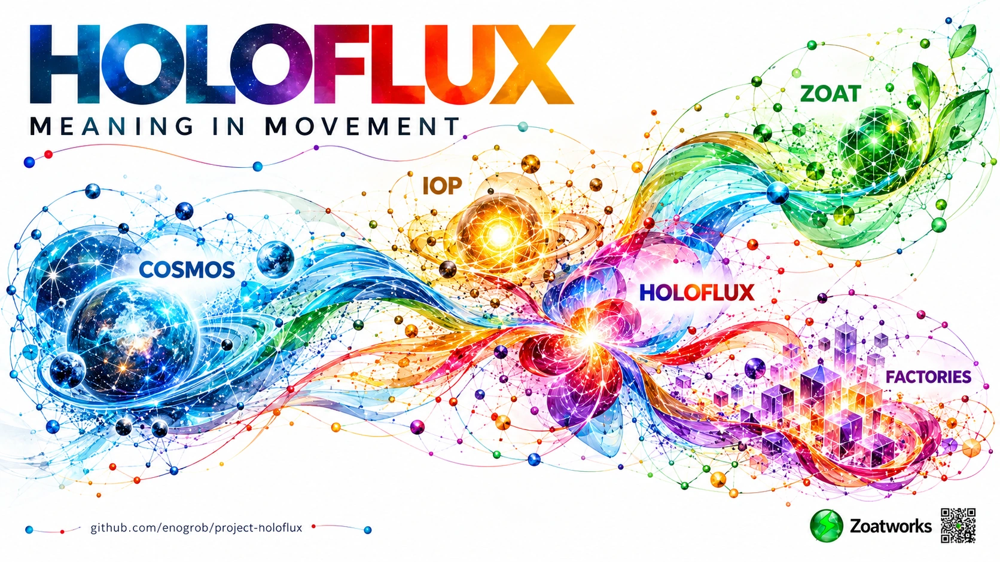
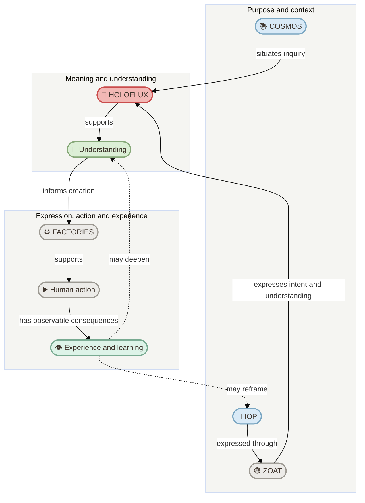
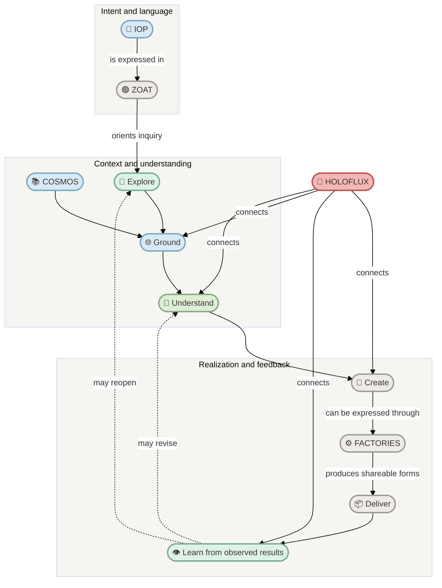

# Project HOLOFLUX

**Ground Architecture** is a human-centered approach to AI-native systems, connecting intent, knowledge, and understanding through the coherent movement of meaning.

At its center, **HOLOFLUX** enables meaning to evolve across context, space, and time—transforming understanding into expression, purposeful action, and continuous learning.

## Contents

- [Summary](#summary)
- [Ground Architecture](#ground-architecture)
- [Concepts Map](#concepts-map)
- [Conceptual Architecture](#conceptual-architecture)
- [Key Concepts](#key-concepts)
- [Guiding Principles](#guiding-principles)
- [Scope](#scope)

## Summary

Ground Architecture brings together five complementary perspectives:

- **COSMOS** gives knowledge a navigable context across domains.
- **IOP (Intent-Oriented Programming)** is a proposed paradigm that orients inquiry and realization around intention and understanding.
- **ZOAT** is the expressive, LLM-native language implementing IOP through meaningful declarations.
- **HOLOFLUX** connects intent and context to meaning, understanding, and expression.
- **FACTORIES** help turn structured meaning into clear, shareable forms.

Together, they describe a human-centered cycle: explore a wider context, develop understanding, create and share useful forms, then learn from the result. The cycle is iterative; experience can reshape both understanding and intent.

## Ground Architecture

These five names describe complementary public concepts in a shared landscape, not a disclosed technical architecture:

| Perspective | Public meaning | Contribution |
| --- | --- | --- |
| **COSMOS** | Knowledge in context | Connects ideas, contexts, and perspectives into a wider view. |
| **IOP** | Intent-oriented paradigm | Connects intention, understanding and realization, remaining open to revision. |
| **ZOAT** | Language implementing IOP | Expresses intentions and understanding through readable, semantically interpreted declarations. |
| **HOLOFLUX** | Meaning in movement | Bridges implicit meaning and explicit expression through inquiry and reflection. |
| **FACTORIES** | Ideas into impact | Explicates understanding into communicable forms for people and audiences. |

## Concepts Map

The map shows how the five perspectives relate at a high level. IOP is the paradigm; ZOAT is its language. Arrows express conceptual relationships, **not** internal integrations or a runtime topology.

In words, COSMOS situates knowledge; IOP articulates the intent-oriented paradigm and ZOAT expresses it as a language; HOLOFLUX describes meaning in movement; FACTORIES helps turn understanding into shareable forms. Action and observed experience may renew understanding and intention.

## Conceptual Architecture

This view follows the recurring Ground Flow: **Explore → Ground → Understand → Create → Deliver → Learn**. *Ground* means situating inquiry within context and available observations. The stages are connected and revisitable. HOLOFLUX describes meaning in movement across the whole, not an isolated processing step.

## Key Concepts

- **IOP and ZOAT:** IOP is the intent-oriented programming paradigm; ZOAT is its expressive language interpreted semantically by LLMs. This public description does not specify execution internals.

- **Intent:** The purpose, questions, goals, and context that give work direction.
- **Knowledge in context:** Ideas and perspectives considered in relation to one another rather than in isolation.
- **Meaning:** Concepts, relationships, and perspectives that help people make sense of a situation.
- **Inquiry:** Exploring questions and observations while remaining open to what is not yet understood.
- **Coherence:** Considering whether interpretations fit their context while recognizing uncertainty.
- **Space and time:** Understanding is situated and may evolve across contexts and moments.
- **Perspectives:** Each expression reveals aspects of a larger whole without exhausting it.
- **Explication:** Making understanding visible and communicable through forms such as explanations, diagrams, or other media.
- **Learning and revision:** Using reflection and experience to refine understanding and reopen inquiry.
- **Human-centered action:** Applying understanding in ways that remain connected to people's needs and judgment.

## Guiding Principles

- Put people and meaning before form.
- Prefer context and connection over fragmentation.
- Use clear expression to make understanding visible.
- Treat any single representation as partial; different forms can reveal different aspects.
- Keep intent and context traceable through the work.
- Make room for reflection, revision, uncertainty, and continuous learning.
- Treat coherence as an ongoing inquiry, not a guarantee of correctness.
- Recognize that understanding evolves across context, space, and time.
- Connect insight to relevant, real-world outcomes.

> **🧠 Understanding**
>
> Understanding is not static. It evolves through inquiry, changing contexts, new perspectives, and experience.
>
> **HOLOFLUX** explores this continuous movement of meaning while remaining open to revision and deeper understanding.

## Scope

This README describes only public concepts and relationships. Diagrams are explanatory maps, not implementation blueprints. Runtime design, orchestration, private interfaces, algorithms, internal configuration, and unreleased capabilities are outside its scope.

Further public background: [ZOAT](https://github.com/ezoatworks/zoat) and [project-skills](https://github.com/enogrob/project-skills). 
