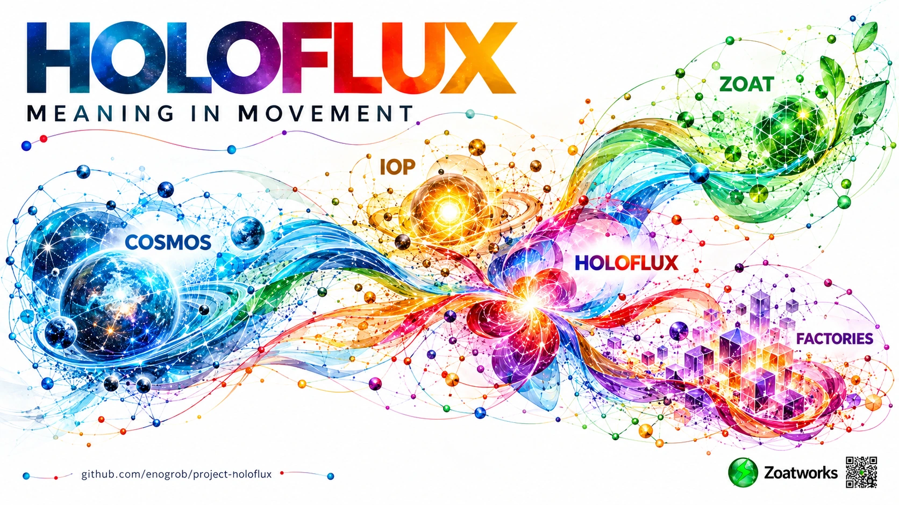
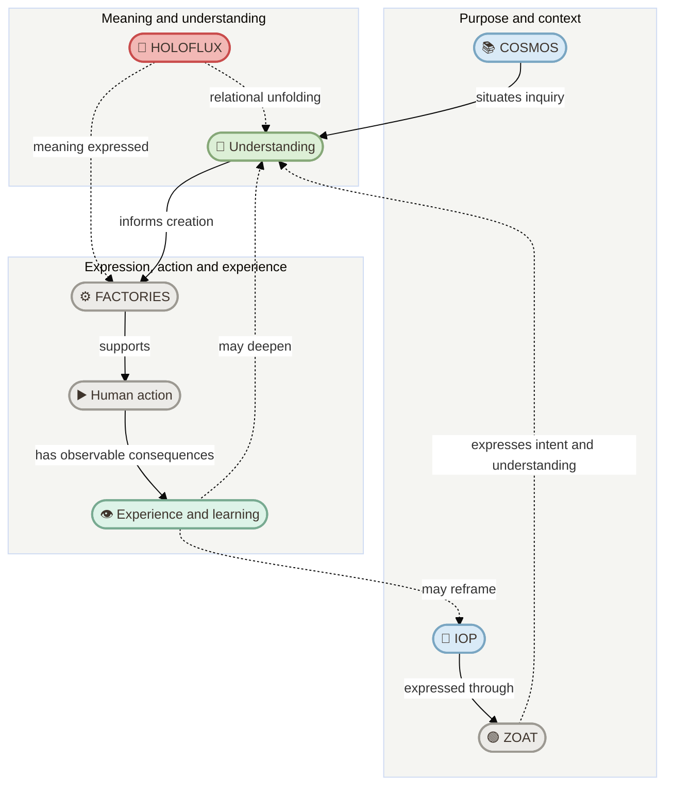
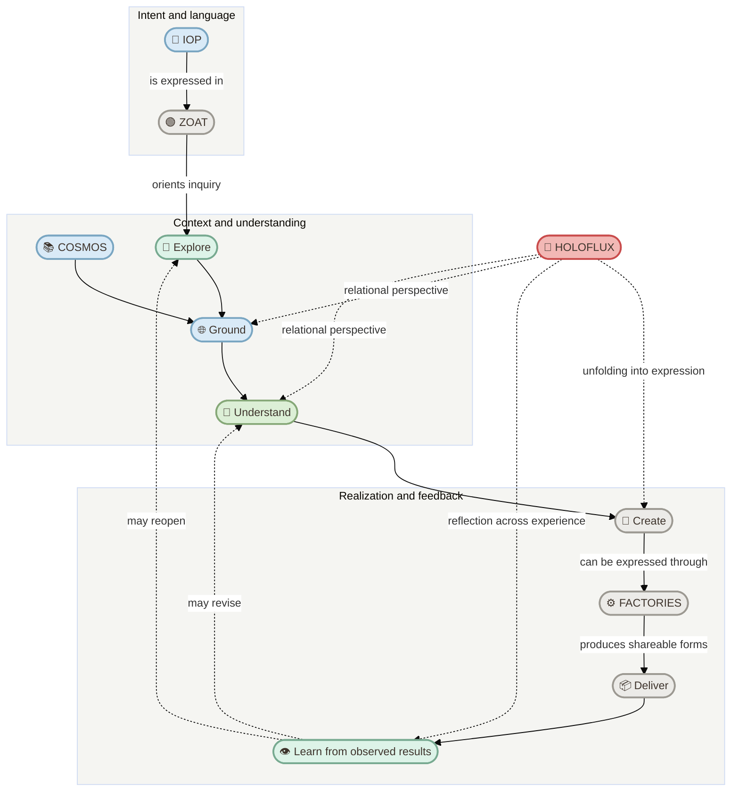

# Project HOLOFLUX

**Ground Architecture** is a human-centered approach to AI-native systems, connecting intent, knowledge, and understanding through the coherent movement of meaning.

At its center, **HOLOFLUX** enables meaning to evolve across context, space, and time—transforming understanding into expression, purposeful action, and continuous learning.

## Contents

- [Summary](#summary)
- [Ground Architecture](#ground-architecture)
- [Concepts Map](#concepts-map)
- [Conceptual Architecture](#conceptual-architecture)
- [Key Concepts](#key-concepts)
- [Guiding Principles](#guiding-principles)
- [Scope](#scope)

## Summary

Ground Architecture brings together five complementary perspectives:

- **COSMOS** gives knowledge a navigable context across domains.
- **IOP (Intent-Oriented Programming)** is a proposed paradigm that orients inquiry and realization around intention and understanding.
- **ZOAT** is an experimental AI-native semantic language for expressing IOP through meaningful declarations; its language contract is maintained in the [ZOAT repository](https://github.com/ezoatworks/zoat).
- **HOLOFLUX** offers the relational perspective of meaning unfolding between implicit understanding and explicit expression; it is not a separate mandatory processing stage.
- **FACTORIES** help turn structured meaning into clear, shareable forms.

**Cosmic Cycles** is complementary, reusable guidance for movements of understanding, realization, and reflection. It is not a sixth Ground Architecture stage, an alternative to HOLOFLUX, or a required execution pipeline; the canonical responsibilities live in [the Cosmic Cycles skill](https://github.com/enogrob/project-skills/tree/main/skills/zoat-cosmic-cycles).

Together, they describe a human-centered cycle: explore a wider context, develop understanding, create and share useful forms, then learn from the result. The cycle is iterative; experience can reshape both understanding and intent.

## Ground Architecture

These five names describe complementary public concepts in a shared landscape, not a disclosed technical architecture:

| Perspective | Public meaning | Contribution |
| --- | --- | --- |
| **COSMOS** | Knowledge in context | Connects ideas, contexts, and perspectives into a wider view. |
| **IOP** | Intent-oriented paradigm | Connects intention, understanding and realization, remaining open to revision. |
| **ZOAT** | Experimental AI-native semantic language for IOP | Expresses intentions and understanding in readable semantic declarations. |
| **HOLOFLUX** | Relational unfolding of meaning | Describes relationships between implicit understanding and explicit expression, across inquiry and reflection. |
| **FACTORIES** | Ideas into impact | Explicates understanding into communicable forms for people and audiences. |

## Concepts Map

The map shows how the five perspectives relate at a high level. IOP is the paradigm; ZOAT is its language. Arrows express conceptual relationships, **not** internal integrations or a runtime topology.

In words, COSMOS situates knowledge; IOP articulates the intent-oriented paradigm and ZOAT expresses it as a language; HOLOFLUX offers the relational perspective of implicit meaning unfolding into explicit forms; FACTORIES helps turn understanding into shareable forms. Action and observed experience may renew understanding and intention.

## Conceptual Architecture

This view follows the recurring Ground Flow: **Explore → Ground → Understand → Create → Deliver → Learn**. *Ground* means situating inquiry within context and available observations. The stages are connected and revisitable. HOLOFLUX describes meaning in movement across the whole, not an isolated processing step.

## Key Concepts

- **IOP and ZOAT:** IOP is the proposed intent-oriented programming paradigm; ZOAT is an experimental AI-native semantic language expressing it. This public description does not claim a verified runtime or reveal execution internals.

- **Intent:** The purpose, questions, goals, and context that give work direction.
- **Knowledge in context:** Ideas and perspectives considered in relation to one another rather than in isolation.
- **Meaning:** Concepts, relationships, and perspectives that help people make sense of a situation.
- **Inquiry:** Exploring questions and observations while remaining open to what is not yet understood.
- **Coherence:** Considering whether interpretations fit their context while recognizing uncertainty.
- **Space and time:** Understanding is situated and may evolve across contexts and moments.
- **Perspectives:** Each expression reveals aspects of a larger whole without exhausting it.
- **Explication:** Making understanding visible and communicable through forms such as explanations, diagrams, or other media.
- **Learning and revision:** Using reflection and experience to refine understanding and reopen inquiry.
- **Human-centered action:** Applying understanding in ways that remain connected to people's needs and judgment.

## Guiding Principles

- Put people and meaning before form.
- Prefer context and connection over fragmentation.
- Use clear expression to make understanding visible.
- Treat any single representation as partial; different forms can reveal different aspects.
- Keep intent and context traceable through the work.
- Make room for reflection, revision, uncertainty, and continuous learning.
- Treat coherence as an ongoing inquiry, not a guarantee of correctness.
- Recognize that understanding evolves across context, space, and time.
- Connect insight to relevant, real-world outcomes.

> **🧠 Understanding**
>
> Understanding is not static. It evolves through inquiry, changing contexts, new perspectives, and experience.
>
> **HOLOFLUX** explores this continuous movement of meaning while remaining open to revision and deeper understanding.

## Scope

This README describes only public concepts and relationships. Diagrams are explanatory maps, not implementation blueprints. Runtime design, orchestration, private interfaces, algorithms, internal configuration, and unreleased capabilities are outside its scope.

## Intellectual References

| Wholeness & unfolding | Mathematical patterns in nature |
| :--- | :--- |
| **David Bohm** · [*Wholeness and the Implicate Order* (1980)](https://www.routledge.com/Wholeness-and-the-Implicate-Order/Bohm/p/book/9780415289795) | **Michael S. Schneider** · [*A Beginner's Guide to Constructing the Universe* (1994)](https://books.google.com.br/books/about/A_Beginner_s_Guide_to_Constructing_the_U.html?id=3JwMAwAAQBAJ) |
| Wholeness, interconnectedness, and the conceptual relationship between implicate and explicate order. | Mathematical archetypes, natural patterns, symmetry, geometry, and proportion. |

**Conceptual relationship:** These are complementary intellectual inspirations for HOLOFLUX's relational perspective and ZOAT's exploration of coherent semantic expression—not evidence of technical implementation or scientific validation.

 
